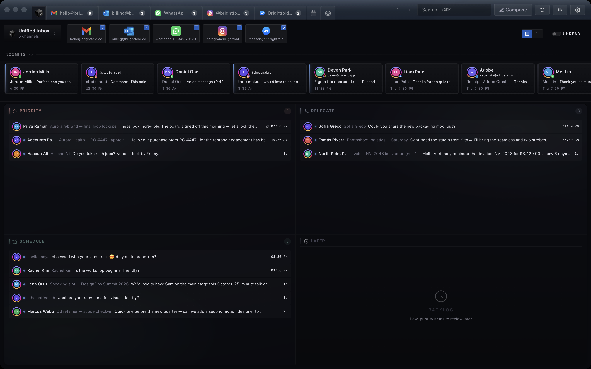
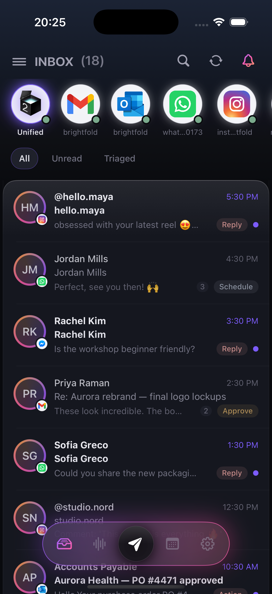
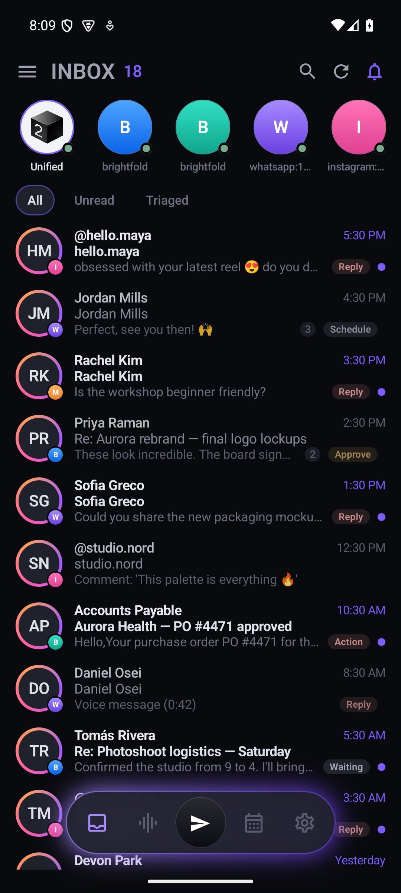
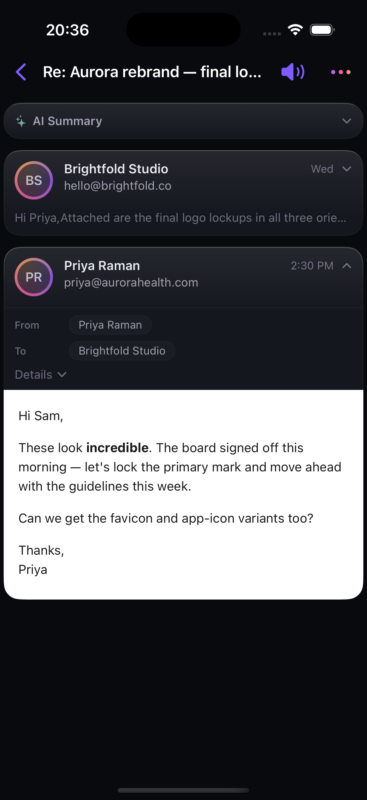

<p align="center">
  
</p>

<h1 align="center">inbox2</h1>

<p align="center">
  Team email for every domain you own.<br>
  <a href="https://inbox2.com"><b>Website</b></a> ·
  <a href="https://mail.inbox2.com"><b>Web app</b></a> ·
  <a href="https://github.com/inbox2/inbox2/releases/tag/cli-latest"><b>Terminal client</b></a> ·
  <a href="docs/"><b>Docs</b></a>
</p>

<p align="center">
  
</p>

<p align="center">
  
  &nbsp;
  
  &nbsp;
  
</p>

## The product

All mail for a connected domain lands in one inbox for the whole team. Each member builds their own views on top of it. Routing rules send a message to a person, an AI agent or a webhook.

You get two parts. Use one or both.

- **The apps.** Native apps for macOS, Windows, Linux, iOS and Android, a web app and a terminal client. Add Gmail, Microsoft 365 or any IMAP account. That mail syncs to your device and stays there. WhatsApp, Instagram and Messenger sit in the same inbox.
- **Hosted mail.** Point a domain's MX records at inbox2. We receive, filter and send its mail, and your team shares it. Calendars, meeting invites and an email sending API come with it.

The native apps keep a local copy of your mail and share one sync engine, written in Rust.

## Repository layout

| Path | Component | Built with | Guide |
|------|-----------|------------|-------|
| [`ui/desktop`](ui/desktop) | Desktop app for macOS, Windows and Linux | Tauri 2, Rust, SQLite | [Tauri-Desktop](docs/Tauri-Desktop.md) |
| [`ui/desktop/core`](ui/desktop/core) | Shared sync engine for every native app: Gmail, Microsoft and IMAP adapters, local search, the MCP server | Rust, UniFFI | [Channels](docs/Channels.md), [Vector-MCP](docs/Vector-MCP.md) |
| [`ui/web`](ui/web) | Web app at mail.inbox2.com and the interface of the desktop app | React 19, Vite, CSS Modules | [Routing](docs/Routing.md) |
| [`ui/ios`](ui/ios) | iPhone and iPad app | SwiftUI on the Rust core | [iOS-App](docs/iOS-App.md) |
| [`ui/android`](ui/android) | Android app | Jetpack Compose on the Rust core | [Android-App](docs/Android-App.md) |
| [`ui/cli`](ui/cli) | Terminal client | Python, Textual | [CLI](docs/CLI.md) |
| [`ui/admin-cli`](ui/admin-cli) | Operator console for the hosted service | Python, Textual | [SaaS](docs/SaaS.md) |
| [`api`](api) | API for hosted mail: domains, teams, calendars, rules and the sending API | Rails 8.1, PostgreSQL | [Reference-Implementation](docs/Reference-Implementation.md) |
| [`mta`](mta) | Mail transport: the MX receiver and the outbound SMTP sender | Go, NATS JetStream | [MX-Inbound](docs/MX-Inbound.md) |
| [`packages/email-body`](packages/email-body) | Email rendering for every app: quotes, signatures, remote content | JavaScript | [Email-Body-Collapsing](docs/Email-Body-Collapsing.md) |
| [`website`](website) | The site at inbox2.com | React Router | |
| [`deploy`](deploy) | Production image for Pushleft | Docker | [Deployment](docs/Deployment.md) |
| [`docs`](docs) | Feature spec, architecture and a guide per component | Markdown | [Feature-Spec](docs/Feature-Spec.md) |

## Run it locally

```sh
# API on :4000 (seed login: demo / password123)
(cd api && bundle install && bin/rails db:create db:migrate db:seed && bin/rails server -p 4000)

# Web app on :4173
(cd ui/web && yarn install --ignore-scripts && INBOX2_API_ORIGIN=http://localhost:4000 yarn dev)

# Desktop app, dev build with demo data (uses the web app above)
(cd ui/desktop && yarn install && yarn dev)

# Tests
(cd api && bundle exec rspec)
(cd ui/web && yarn lint && yarn vitest run --project unit)
```

Attachments need the local object store: `docker compose -f docker/docker-compose.yml --profile storage up -d`, then `bin/garage-init`. The full setup, per component, is in [CLAUDE.md](CLAUDE.md).

## Releases

A push to `main` runs these GitHub Actions workflows. The iOS, Android and terminal client workflows run only when their code or the Rust core changes.

| Target | Workflow | Destination |
|--------|----------|---------------|
| Hosted service | [`deploy.yml`](.github/workflows/deploy.yml) | api.inbox2.com, mail.inbox2.com and inbox2.com |
| Desktop app | [`desktop.yml`](.github/workflows/desktop.yml) | The Update button in every installed copy ([Desktop-Release](docs/Desktop-Release.md)) |
| iOS app | [`ios.yml`](.github/workflows/ios.yml) | TestFlight ([iOS-TestFlight](docs/iOS-TestFlight.md)) |
| Android app | [`android.yml`](.github/workflows/android.yml) | Firebase App Distribution |
| Terminal client | [`cli-release.yml`](.github/workflows/cli-release.yml) | [`cli-latest`](https://github.com/inbox2/inbox2/releases/tag/cli-latest) |

## Licensing

This repository uses two licenses, split by component:

| Path | License | Scope |
|------|---------|----------------|
| everything not listed below: `ui/*` (desktop, iOS, Android, web, CLI and the shared Rust core), `website/`, `docs/` | [Apache-2.0](LICENSE) | The apps and everything a user installs. |
| `api/` | [FSL-1.1-ALv2](api/LICENSE.md) | Rails API (hosted mail) |
| `mta/` | [FSL-1.1-ALv2](mta/LICENSE.md) | Go mail transport (MX inbound and SMTP outbound) |
| `deploy/` | [FSL-1.1-ALv2](deploy/LICENSE.md) | Deployment |

In short:

- **The apps are open source** (Apache-2.0). Use, change, embed and share them under the standard Apache terms.
- **The server is Fair Source** ([FSL](https://fsl.software)). You can read it, change it and run it for your own organisation. A consultant can run it for a customer. You can't sell it to others as a competing service. Each release becomes Apache-2.0 two years after publication.

Bundled third-party code and fonts are in [THIRD_PARTY_NOTICES.md](THIRD_PARTY_NOTICES.md); see also [NOTICE](NOTICE).

"inbox2" is a trade name of Sadiq Beheer B.V. The licenses don't cover the name or the logo.

## Contributing

Pull requests are welcome. Read [CONTRIBUTING.md](CONTRIBUTING.md) first. Every commit needs a [Developer Certificate of Origin](https://developercertificate.org) sign-off (`git commit -s`).

Report security problems to security@inbox2.com, never in a public issue ([SECURITY.md](SECURITY.md)).
