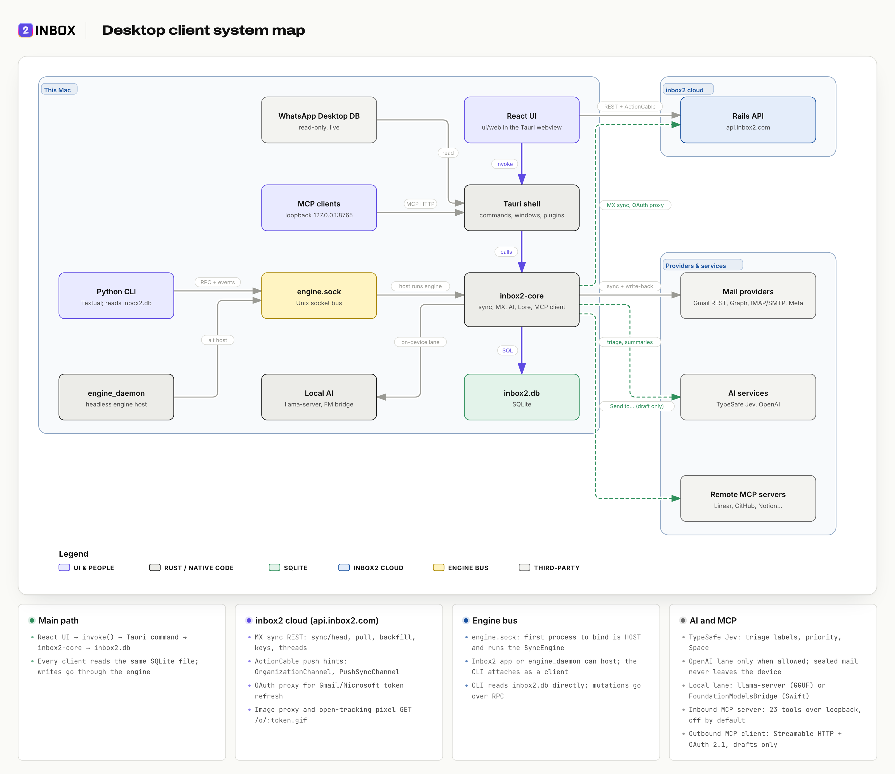
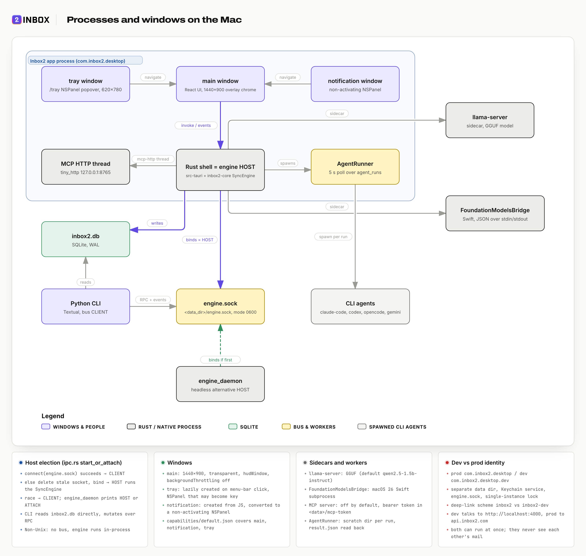

## The product

inbox2 Desktop is the macOS, Windows and Linux client for inbox2, the collaborative domain-based team email product. It shows two kinds of mail in one inbox:

- **MX mail**: mail for a domain hosted on inbox2. The server owns it. The desktop mirrors it locally so the app opens instantly and works offline for reading.
- **Local channels**: Gmail, Microsoft 365, IMAP mailboxes and Meta channels (WhatsApp Business, Messenger, Instagram) that the person connects. The desktop syncs these itself, directly from the provider. The inbox2 server never sees that mail.

Around the inbox sit a calendar, Lore, on-device AI, local rules, an MCP server, local WhatsApp and the Touch Strip. The calendar is server-side for MX and provider-side for local channels. Lore is the to-do and entity layer mined from mail. On-device AI gives summaries, smart replies and Jev triage. Local rules can run a coding agent. The MCP server lets AI agents use the inbox. Local WhatsApp is macOS only.

> **Decision** Two sync modes, never conflated. MX syncs with the Rails API and PostgreSQL. Local channels are client-side SQLite and never touch the API. A feature that spans both needs two paths. Source: `CLAUDE.md`, Architecture invariants.

## The three layers



| Layer | Where | Owns |
|---|---|---|
| **UI** | `ui/web` (React 19, Vite, CSS Modules) | Every screen. The same code builds the web app at `mail.inbox2.com`; `isTauri()` gates the desktop-only parts. |
| **Shell** | `ui/desktop/src-tauri` (Tauri 2, crate `inbox2-desktop`) | Windows, menu, tray, plugins, 183 `#[tauri::command]` functions the UI calls with `invoke`, the engine host, the MCP server, the agent runner, vectors, WhatsApp, the AI sidecars. |
| **Core** | `ui/desktop/core` (crate `inbox2-core`) | The sync engine, provider adapters, the MX mirror, the write-back queue, calendar, secrets, AI lanes, triage, Lore mining, rules, the MCP client. Host-agnostic: it also compiles to a UniFFI library for iOS and Android. |
| **Data** | `inbox2.db` in the app data directory | One SQLite file. Channel mail in `conversations`/`messages`, MX mail in `mx_*`, plus queues, secrets, calendar, Lore, vectors, agents. |

Every write goes through a command. The UI calls it, the shell forwards it to the core, and the core writes SQLite and talks to the network. Reads go the short way. The UI opens `sqlite:inbox2.db` through `tauri-plugin-sql` and queries the tables directly (`web/lib/db.js`, `web/lib/localFirstApi.js`).

## Processes on the machine



The Inbox2 app is one process with three windows: `main`, `tray` (the menu-bar popover) and `notification` (the card stack that floats over other apps). The engine runs inside the process that wins the socket election on `engine.sock`. Normally that is the app, otherwise `engine_daemon`. The Python CLI attaches as a client of that socket and reads SQLite directly. The shell starts four kinds of sidecar. `llama-server` serves the free AI lane. `FoundationModelsBridge` serves Apple Intelligence. The MCP HTTP listener serves agents. Rules spawn coding agents.

> **Decision** One engine across the desktop app and the CLI, elected by socket file. Two engines would poll Gmail twice and race the write-back queue. Source: `docs/CLI.md`, `docs/Channels.md`.

## Dev and prod identities

| | Prod | Dev |
|---|---|---|
| Bundle id | `com.inbox2.desktop` | `com.inbox2.desktop.dev` |
| Name | Inbox2 | Inbox2 Dev (golden badge) |
| Config | `tauri.conf.json` (+ `tauri.release.conf.json` for releases) | `tauri.dev.conf.json` |
| API | `api.inbox2.com` baked in at build (`VITE_API_ORIGIN`) | `localhost:4000` |
| Deep-link scheme | `inbox2` | `inbox2-dev` |
| Data dir, Keychain item, socket, single-instance lock | own | own |

Both can run at the same time. `yarn dev` in `ui/desktop` runs the dev identity against the Vite server on :4173. `yarn install:app` builds the prod identity into `/Applications` and stamps it with `bin/version`, so it joins the update stream.

> **Watch out** Frontend code must use `apiBaseUrl()`, because the webview runs on `tauri://localhost` and `window.location.origin` is wrong there. Do not run `cargo build` against the desktop crates while `tauri dev` is running; it contends for the Cargo lock and looks like a hang.

## Repository layout

```text
ui/web/src/            React UI (pages/, components/, hooks/, lib/, stores/)
ui/desktop/core/       inbox2-core: src/sync/{store,engine,adapters,...}, src/bridge, src/rules, src/mcp_client
ui/desktop/core/migrations/001_create_schema.sql   the one schema file
ui/desktop/src-tauri/  inbox2-desktop: src/sync/commands/*, src/mcp, src/local_agents, src/vector, src/ai, src/whatsapp*
ui/desktop/src-tauri/src/bin/engine_daemon.rs      headless engine host for the CLI
ui/cli/                Python/Textual CLI over the engine bus
bin/release-desktop    the release command
docs/                  the long-form docs this book condenses
```
