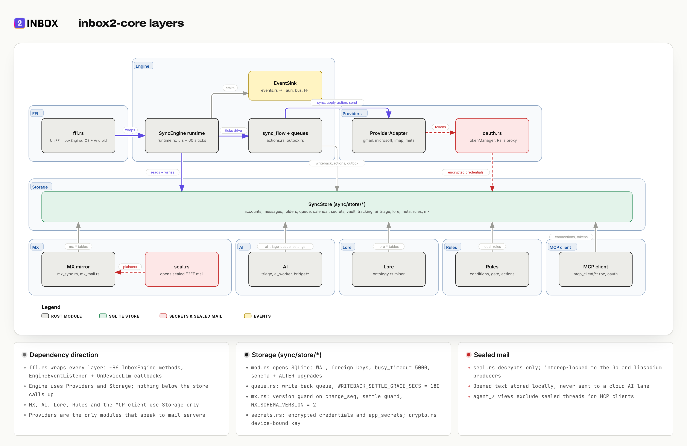

## Crates

| Crate | Path | Role |
|---|---|---|
| workspace | `ui/desktop/Cargo.toml` | members `core` and `src-tauri`, resolver 2. Release profile keeps `strip = false`: stripping removed the `__TAURI_BUNDLE_TYPE` symbol the updater needs, and on macOS 27 stripped proc-macros fail in dyld. |
| `inbox2-core` | `ui/desktop/core` | lib `inbox2_core`, crate types `staticlib`, `cdylib`, `rlib`. Features: `test-support` (in-memory store helpers), `mobile-ffi` (UniFFI plus oslog / android_logger), `os-keychain` (keyring wraps the credential master key; desktop only). Binaries: `uniffi-bindgen`, `triage-eval`. |
| `inbox2-desktop` | `ui/desktop/src-tauri` | lib `app_lib`, bin `inbox2-desktop`, plus `engine_daemon` and `sync_check`. Depends on the core with `os-keychain`. |

Key core dependencies: rusqlite 0.32 (bundled, capped because `tauri-plugin-sql`'s sqlx pins `libsqlite3-sys`), tokio, reqwest (rustls), imap, lettre, mailparse, ammonia. For E2EE: aes-gcm, crypto_box, chacha20poly1305, argon2, zeroize. Also hmac (Meta), toml (prompts), tar and bzip2 (model bundles), image, chrono-tz. Android adds a vendored OpenSSL.

The same core serves four clients. The desktop uses it as a path dependency. iOS and Android use it through UniFFI. `core/ffi.rs` exports the object `InboxEngine` with about 96 methods and the callback interfaces `EngineEventListener` and `OnDeviceLlm`. `core/build-ios-xcframework.sh` and `core/build-android-jni.sh` build it. The CLI reaches it through the shell's engine bus (chapter 1).

## Module layers

| Layer | Modules (`core/`) | Owns |
|---|---|---|
| Storage | `sync/store/mod.rs` (open, schema, upgrades, checkpoint, integrity), `accounts.rs`, `messages.rs`, `folders.rs`, `queue.rs` (write-back, outbox, `WRITEBACK_SETTLE_GRACE_SECS = 180`), `calendar.rs`, `secrets.rs`, `vault.rs`, `tracking.rs`, `ai_triage.rs` (`engine_settings`, triage queue, spaces, labels), `lore.rs`, `lore_triage.rs`, `meta.rs`, `rules.rs`, `mx.rs` (the MX mirror: version guard on `change_seq`, settle guard, full-thread replace, reconcile, `MX_SCHEMA_VERSION = "2"`) | every SQL statement |
| Model | `sync/model.rs` (unified types, `ProviderType`, `ApiContext`), `error.rs`, `threading.rs`, `mime.rs`, `deletion.rs`, `retry.rs` (backoff), `quotes.rs`, `otp.rs`, `crypto.rs` (device-bound key, `.credential_key` or the OS keychain) | shared types and helpers |
| Providers | `sync/provider.rs` (`ProviderAdapter`: connect, list folders, initial and incremental sync, watch, push subscriptions, apply action, flag normalisation), `sync/adapters/{gmail_mail,microsoft_mail,imap_adapter,meta,gmail_labels}.rs` and `create_adapter`, `sync/interactive.rs` (`InteractiveProvider`: fetch, send, search, attachments; Gmail, Microsoft, IMAP over SMTP via lettre, Meta), `sync/oauth.rs` (`TokenManager`), `sync/meta_normalize.rs`, `meta_push.rs` | talking to a mailbox |
| Engine | `sync/engine/mod.rs` (`SyncEngine`, event names), `runtime.rs` (the loop), `sync_flow.rs`, `queues.rs`, `conversation_actions.rs`, `calendar.rs`, `tracking.rs`; `sync/actions.rs` (write-back queue), `outbox.rs` (durable sends), `events.rs` (`EventSink`, `NullSink`, `CompositeSink`), `push.rs` (Gmail watch and Graph subscriptions) | the schedule and the write path |
| MX | `sync/mx_sync.rs` (the bounded, resumable pass), `mx_mail.rs` (MX writes the bulk queue does not cover), `seal.rs` (opens sealed E2EE mail; interop fixtures for libsodium and Go), `vault.rs` and `vault_sync.rs` (zero-knowledge credential vault, Argon2id KEK) | inbox2-hosted mail |
| Calendar | `sync/calendar.rs` (`CalendarAdapter`: Google, Microsoft), `ics.rs` (RFC 5545 reader) | provider calendars and invites |
| AI | `triage.rs`, `ai_worker.rs` (`TriageWorker`), `typesafe.rs` (Jev), `triage_eval.rs`, `next_action.rs`, `bridge/{mod,brief,agent,intent,email_voice,openai,tools,prompts}.rs`, `bridge/prompts.toml`, `bridge/models/` (three-lane manager, resumable sha256-checked downloads) | judgments and text generation |
| Lore | `ontology.rs` | the local entity miner |
| Rules | `rules/{conditions,gate,actions,ai}.rs` | the local-channel rule funnel |
| MCP client | `mcp_client/{mod,oauth,rpc}.rs` | outbound "Send to…" |
| FFI | `ffi.rs` | the mobile surface |

Five areas live in the shell: the MCP server (`shell/mcp/`), agentic filters and the `AgentRunner` (`shell/local_agents/`), vectors and embeddings (`shell/vector/`), notifications and the device link, and WhatsApp.

## The run loop

`core/sync/engine/runtime.rs` `run()` is a `select!` over provider events, a 5 s tick and a 60 s tick.

| Tick | Work |
|---|---|
| provider event | reconnect backoff per account (one sleeper task; the previous one is aborted) |
| 5 s | write-back drain, outbox drain, cleanup, `drain_backup_dirty` (vault), `mx_drain`, `mx_outbox_drain`, passive WAL checkpoint |
| 60 s | `poll_all_accounts` (reconnects errored accounts, respects the Gmail lockout), calendars, `mx_tick` (MX failsafe plus `mx_push_busy`), `renew_push_due`, `renew_meta_push_due`, `ensure_custom_hosts_registered`, `poll_tracking_opens` |

Boot (`shell/setup.rs` `init_engine`): `boot_all_accounts`, then one-time backfills (`backfill_html_body_text`, `reindex_mx_html_search_text`, `backfill_attachment_filenames`).

> **Watch out** A one-time backfill that scans a whole table synchronously at boot shows up as a cold-start stall on every client. Gate it behind an `engine_settings` marker so it runs once.

## Workers

| Worker | Where | Cadence |
|---|---|---|
| Engine bus host | `shell/sync/ipc.rs` `start_or_attach` / `serve` | a std thread; the host runs the engine, a client attaches with `BusClient` |
| TriageWorker | `core/ai_worker.rs`, spawned by `setup::init_ai_subsystems` | 5 s poll, 90 s generation timeout |
| Embedding pipeline | `shell/vector/pipeline.rs` | batches of 50, 5 s sleep |
| AgentRunner | `shell/local_agents/runner.rs` | 5 s poll; adapters claude-code, codex, opencode, gemini |
| Lore miner | `core/ontology.rs` `run` | 60 s |
| WhatsApp Lore | `shell/whatsapp_lore.rs` `run` | 20 s, idle until enabled |
| Updater | `shell/updater.rs` `check_on_startup` | 3 s after launch, then every 2 min; release builds only |
| Display watcher | `shell/setup.rs` `spawn_display_watcher` | std thread |
| MCP HTTP | `shell/mcp/http.rs` | the `mcp-http` thread |

`engine_daemon` (`shell/bin/engine_daemon.rs`) runs the same set without a window. That set is the engine, the vector store, the embedding pipeline, the agent runner, the triage worker, the Lore miner and WhatsApp Lore. It prints `HOST <sock>` or `ATTACH <sock>` so the CLI knows which it got.

## Events the core emits

`sync`, `new-message`, `calendar-changed`, `status`, `outbox-changed`, `triage-progress`, `triage-updated`, `space-updated` (engine), `mx-sync` (`mx_sync.rs`), `model-download` (`bridge/models/download.rs`). Every client, the CLI included, refreshes on these events.
