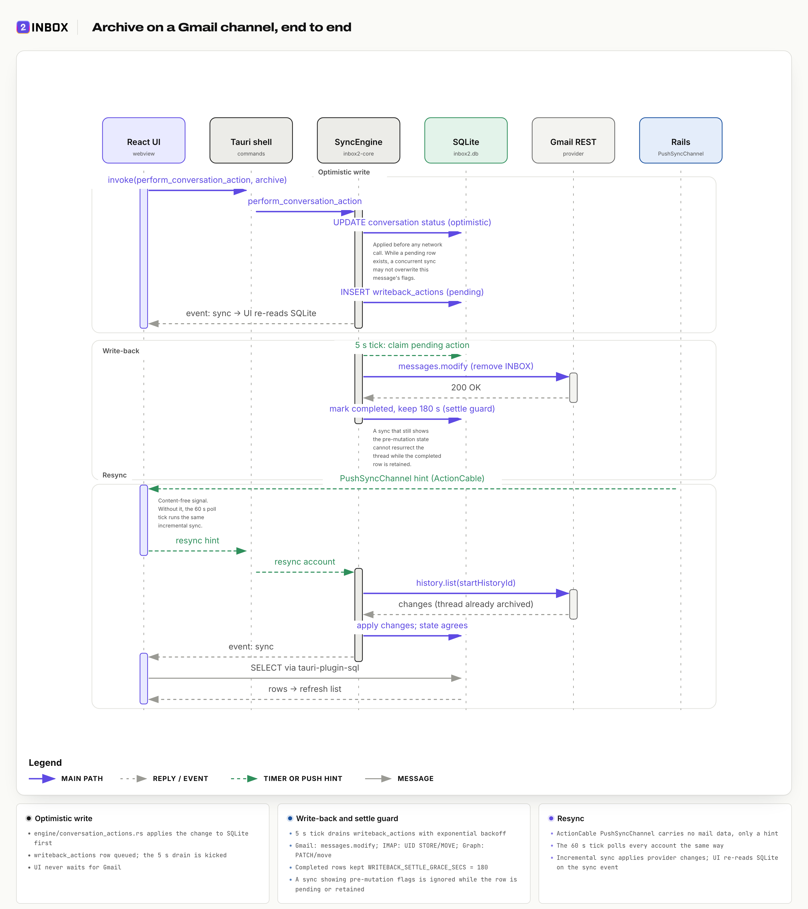
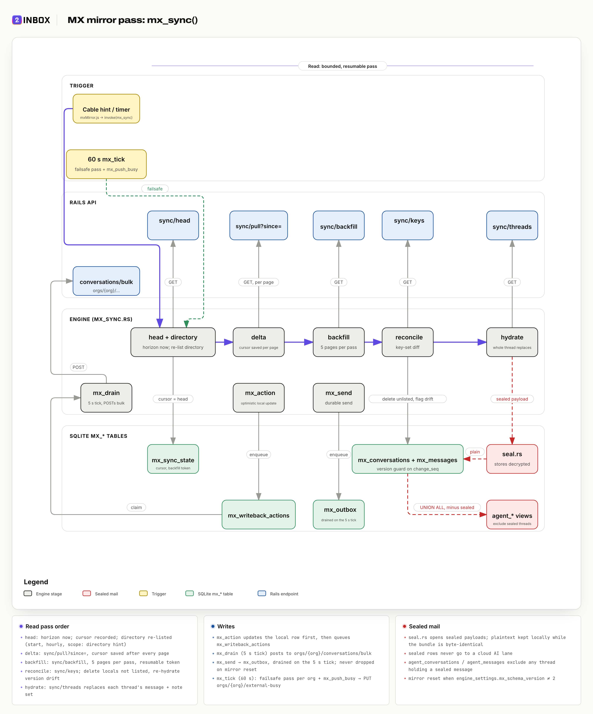

## Local channels

A connected mailbox is an `external_accounts` row with encrypted credentials. The core creates a `ProviderAdapter` for its type (`create_adapter`): Gmail REST, Microsoft Graph, IMAP, or Meta. The adapter connects, lists folders and runs an initial sync of the folders the person selected (`inbox2_sync_folders`). After that it syncs incrementally on the 60 s tick, on a push hint, or when the provider's watch fires.

| Provider | Read | Write | Push |
|---|---|---|---|
| Gmail | `gmail_mail.rs`, REST `messages.list/get` in paced chunks | `gmail_labels.rs`, modify labels | Pub/Sub watch via Rails |
| Microsoft 365 | `microsoft_mail.rs`, Graph delta | Graph patch/move | Graph subscription via Rails |
| IMAP | `imap_adapter.rs`, UID ranges | IMAP flags and copy; SMTP via lettre | none (poll) |
| Meta | `adapters/meta.rs`, Graph | `MetaInteractive` send | webhook relay, HMAC-verified (`meta_push.rs`) |

Interactive operations (`InteractiveProvider`) are the on-demand calls: fetch a full message, search the provider, download an attachment, send.

> **Watch out** Gmail signals quota with HTTP 403 ("Quota exceeded per minute per user"). The core treats it as transient and paces `messages.get`. A 403 of this kind must stay transient and never become `needs_reauth`. The shared core means a mistake here also hits iOS and Android.

### Tokens

`sync/oauth.rs` `TokenManager` refreshes locally when the build carries client credentials, otherwise through the Rails proxy. First authorisation always goes through the proxy (`start_gmail_oauth`, `start_microsoft_oauth`, loopback redirect). A 4xx on refresh marks the account `needs_reauth`; the re-auth prompt is rate-limited to one per 5 minutes (`claim_reauth_prompt`).

### Writes: optimistic, then queued



A conversation action (`perform_conversation_action`, `set_priority`, `move`, …) does two things in one transaction. It updates the local row's status and read flags (`updated_at` stays), and it appends a `writeback_actions` row. The 5 s tick drains the queue with backoff (`sync/actions.rs`). A completed action is kept for `WRITEBACK_SETTLE_GRACE_SECS` (180 s). A sync page fetched before the provider applied the change can then not bring the old state back.

Sends and drafts are `outbox_messages` rows (`sync/outbox.rs`): durable, retried, listed and retryable from the UI (`list_outbox`, `retry_outbox_message`). MCP sends go through the same table.

> **Decision** Optimistic local write followed by a write-back queue with an agreement-based settle guard. Source: `CLAUDE.md`, `docs/Channels.md`.

### Cloud push

For Gmail and Microsoft the engine itself creates the provider watch or subscription (`sync/push.rs`) and tells Rails only the mapping (`register_push`). When the provider notifies Rails, Rails broadcasts a content-free "mailbox X changed" over ActionCable. The UI's `web/lib/pushSync.js` subscribes to `PushSyncChannel` and asks the engine to resync that account. Meta events arrive the same way and are ingested with `ingest_meta_event`. Renewal runs on the 60 s tick. When push is off or expired, the 60 s poll covers the account.

> **Decision** The provider token never leaves the client. Rails learns that a mailbox changed, never what changed. Paid plans only; the toggle defaults to on. Source: `docs/Cloud-Push.md`.

## MX mail: the mirror

MX mail lives on the server. The core keeps a local copy in the `mx_*` tables so the desktop opens instantly and reads work offline. One function, `SyncEngine::mx_sync(org, user_key, opts)` (`core/sync/mx_sync.rs`), runs a bounded, resumable pass. A mutex serialises it so two triggers cannot interleave.



| Stage | Endpoint | What it does |
|---|---|---|
| head | `sync/head` | the server's cursor; nothing to do if it matches |
| directory | (directory endpoints) | org, domains, mailboxes, members, tags, spaces, triage labels, views, into `mx_directory` |
| delta | `sync/pull?since=` | changed threads in commit order (`change_xid`, `change_seq`); the cursor is saved after every page, so an interrupted pass resumes |
| backfill | `sync/backfill` | older history, newest first, 5 pages per pass, until `backfill_done` |
| reconcile | `sync/keys` | compares the held key set with the server's; hourly, on request, or when asked by a hint |
| hydrate | `sync/threads` | full threads for whatever the stages above flagged; a thread is replaced whole |

The cursor is a trigger-stamped `change_seq`/`change_xid` pair with a transaction horizon, which makes commit order safe. Tombstones carry `parent_key`; losing visibility of a thread is a delete. A version guard refuses an older page. A settle guard holds a row for 60 s after a local write (`DONE_GRACE`) and lapses after 15 min (`SETTLE_WINDOW`). A read that races a write can then not undo it.

Triggers: the UI calls `mx_sync` when the app opens and on an ActionCable `sync` hint (`web/lib/mxMirror.js`). The 60 s tick runs `mx_tick` as a failsafe. The same tick pushes busy blocks from local calendars (`mx_push_busy` → `PUT orgs/{org}/external-busy`, deduplicated by a digest in `engine_settings`).

> **Decision** D1 to D6 of 2026-09-20. The MX client lives in the Rust core. All history is mirrored (`mx_sync_window_days`, default 0 = unlimited). The directory syncs too. Sealed mail is stored decrypted locally under five conditions. The generic `sync/push` column push was deleted and writes replay the real REST endpoints. Every step was reviewed by Codex. Source: `docs/MX-Sync.md`.

### MX writes

`mx_action` appends to `mx_writeback_actions`; `mx_drain` (5 s tick) replays them to `orgs/{org}/conversations/bulk`. Sends go to `mx_outbox` and `mx_outbox_drain`. Both tables survive a mirror reset. The webview's own drain (`mxWriteback.js`) was deleted: the engine is the one owner of the queue on every platform. Composing stays online; sending while offline is out of scope.

### MX mail in the UI

Mail pages import `web/lib/localFirstApi.js` (an ESLint rule bans `web/lib/api.js` there). It answers from `localData.js` when the mirror is complete for the signed-in user (`backfill_done`), and falls through to the API otherwise. A `null` from the mirror means "not synced yet", and the API answers. Search goes local first too: `localFirstApi.search()` queries the mirror's own FTS5 index (`mx_messages_fts`, through `localData.searchLocal`) and falls back to the API when the mirror cannot answer. Unread counts stay on the API by decision: unread badges are one of the things the mirror leaves out (below). The comment in `localFirstApi.js` that gives "no domain column" as the reason is stale; `mx_conversations.domain_key` exists.

```javascript
// web/lib/localFirstApi.js
async getConversations(orgId, params = {}) {
  const localResult = await local.getConversations(orgId, params);
  if (localResult) return localResult;
  return remoteApi.getConversations(orgId, params);
}
// Badge count: always server-side (unread badges are not a mirror opt-in).
getUnreadCount(orgId, params) { return remoteApi.getUnreadCount(orgId, params); }
```

### Sealed mail

A sealed (E2EE) domain's messages arrive as ciphertext. `mx_messages.sealed = 1` marks such a row; its `payload` keeps the ciphertext bundle verbatim, so API-shaped reads see what the server sent. `core/sync/seal.rs` opens the bundle with the member's key and stores the result (`{"header": …, "body": …}`) in the separate `plain` column. The UI hands the key to the engine with `mx_set_domain_keys`; it stays in that process and stays off the engine bus. Sealed rows stay out of every cloud AI lane, out of summaries and out of the `agent_*` views. The org's rows are wiped on sign-out, on an identity switch and when the grant is lost.

### Features MX leaves out

Bridge, the on-device triage worker (the server's Jev is authoritative), local rules, vector embeddings and unread badges. Each would be its own decision.

