## Routes

Boot: `web/main.jsx` → `BrowserRouter` → `AuthProvider` → `web/routes.jsx`. `ProtectedRoute` sends a Tauri app that has not finished setup to `/setup`. A standalone desktop (no inbox2 account) skips login. Otherwise it shows `OfflinePage` when the API is down, or goes to `/login`. `OrgRedirect` at `/` restores the saved account (`inbox2_active_account`) and conversation (`?c=`), else `/:org/mail`. On Tauri with no org the home is `/mail`.

| Route | Page | Scope |
|---|---|---|
| `/mail`, `/:org/mail` | `pages/inbox/UnifiedInboxView.jsx` | Both |
| `/mail/account/:accountKey`, `/:org/mail/account/:accountKey`, `/:org/mail/inbox` | `pages/inbox/InboxPage.jsx` | Both |
| `/mail/search`, `/:org/search` | `pages/search/SearchResultsView.jsx` | Both |
| `/explorer`, `/:org` | `pages/command/CommandCenterPage.jsx` | Both |
| `/lore/*` | `pages/lore/LoreApp.jsx` (+ Entity, Peek, Today, Views, WaGroup) | Both |
| `/:org/calendar`, `/:org/calendar/:eventId` | `pages/calendar/CalendarPage.jsx` | Both |
| `/spaces`, `/:org/spaces` | `pages/dashboard/SpaceDashboard.jsx` | Both |
| `/:org/team/:memberId` | `pages/dashboard/MemberActivityPage.jsx` | MX |
| `/whatsapp`, `/:org/whatsapp` | `pages/whatsapp/WhatsAppPage.jsx` | Desktop (route exists only under `isTauri()`) |
| `/settings`, `/:org/settings` | `pages/settings/SettingsPage.jsx` | Both |
| `/setup` | `pages/setup/SetupWizardPage.jsx` | Desktop; forced until complete |
| `/notification`, `/tray` | `pages/notification/NotificationPage.jsx`, `pages/tray/TrayPage.jsx` | Desktop aux windows |
| `/triage-lab` | `pages/lab/TriageLabPage.jsx` | Desktop, dev mode |
| `/login`, `/signup`, `/forgot-password`, `/reset-password`, `/link`, `/sso/*`, `/accept-invite`, `/oauth/consent` | `pages/auth/*` | web; the desktop login runs the device link |
| `/console/*` | `pages/admin/*` | **web only**: on Tauri `ConsoleLayout` opens the hosted console in the system browser and renders nothing |
| `/disk/*` | `pages/disk/*` | **web only**: Tauri redirects to `/` |

Six components mount globally: `CommandPalette`, `TimeZonePlanner`, `NewMessageNotifier` (notifications, meeting reminders, zone alerts, dock badge, tray title, unread counts), `ActivityPanel`, `ReauthPrompt` and `AppMenuBridge`. The aux windows and the Disk and console hosts skip them.

## Setup wizard

The steps are in `pages/setup/steps/*`, the state in `hooks/useSetupWizardState.js`. The order is `intro`, `welcome` (MX or standalone), `look` (theme, text size), `account-select`, then `account-configure`, `meta-configure` or `oauth-waiting`, then `ai`, `enrich`, `complete`. The MX path ends at sign-in, which `/login` takes over in the wizard's look. `inbox2_setup_complete` records `mx` or `standalone`.

## Mail

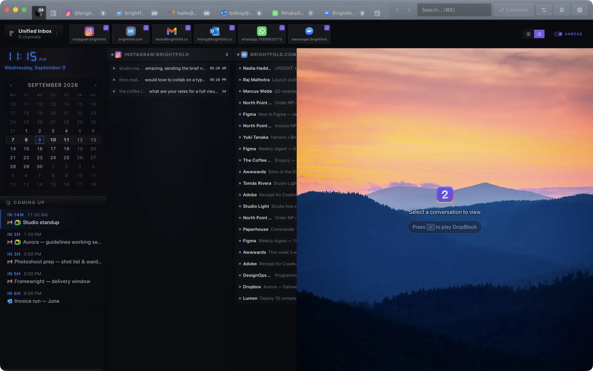

| Feature | Code | Scope |
|---|---|---|
| Unified inbox: grid and list (`inbox2_unified_view_mode`), unread-only, calendar rail, Eisenhower matrix, Lore Today panel, hover preview | `UnifiedInboxView.jsx`, `hooks/useUnifiedInbox.js`, `components/ListViewColumns`, `EmailCard`, `EisenhowerMatrix`, `Lore/LorePanel.jsx`, `Calendar/CalendarRail.jsx`, `EmailPreviewPopup`, `hooks/useHoverPreview.js` | Both |
| Channel inbox: folders, saved views, tags, Meta sub-views, sort, resizable panes, context panel | `InboxPage.jsx`, `hooks/useInboxConversations.js`, `useFolderViews.js`, `useViewsAndTags.js`, `useSortOrder.js`, `usePanelResize.js`, `components/InboxSidebar`, `InboxContextPanel`, `lib/folderRoles.js` | Both |
| Spaces filter (`?space=`) and the Spaces board (treemap) | `hooks/useSpaces.js`, `pages/dashboard/SpaceDashboard.jsx`, `hooks/useSpaceBoard.js`, `components/SpaceTreemap`, `SpacesPaywall` | Both; the Spaces settings page is hidden on desktop |
| Conversation list, rows, quick actions, loading ghosts | `components/ConversationList`, `ConversationItem`, `QuickActions`, `SocialListRow`, `Ghosts` | Both |
| Reading pane: HTML in a sandboxed `<iframe srcdoc>` (`allow-same-origin`, no scripts, strict CSP), plain text inline, chat threads, comments, notes, details, view source | `components/ConversationDetail`, `MessageCard/MessageCard.jsx`, `EmailFrame.jsx`, `buildSrcDoc.js`, `sanitizeEmailHtml.js`, `ChatThread`, `CommentCard`, `NoteCard`, `MessageDetails`, `ViewSourceModal` | Both |
| Pane modes pinned / floating / hidden | `hooks/usePaneMode.js` (`inbox2_preview_pane_mode`, `inbox2_calendar_rail_mode`, `inbox2_lore_pane_mode`) | Both |
| Quote and signature collapsing | `MessageCard/QuotedText.jsx`, shared package `packages/email-body` | Both |
| Actions: archive, trash, spam, read, unread, move to inbox; undo and redo | `lib/conversationActions.js` (`CONV_ACTION`), `hooks/useConversationActions.js`, `stores/undoStore.js`, `UndoToast`; local via `perform_conversation_action`, MX via `mxMirror.js` `mx_action` | Both |
| Mark-as-read: immediate, delay (default 2.5 s), on selection change, never | `lib/markReadPref.js`, `hooks/useMarkRead.js` | Both |
| Priority quadrants (Priority, Schedule, Delegate, Later) | `lib/priority.js`, `lib/mxPriority.js` (MX stores them as tags), `set_priority` / `clear_priority`, `hooks/useManualTriage.js` | Both |
| Jev triage labels, re-triage, label and space override, progress | `lib/triage.js`, `hooks/useTriageLabels.js` (local `get/set_triage_labels`, MX `/orgs/:id/triage-labels`), `TriageLabelsEditor`, `retriage_conversation`, `ActivityPanel` | Both; MX label settings are web only |
| Compose, reply, forward; rich editor; from identity; attachments; AI compose | `components/ComposePopup/*`, `Composer`, `RichEditor` (TipTap), `FromSelect`, `DraftBar`, `AIComposePopup`, `hooks/useDraftActions.js`, `useFromIdentities.js`, `lib/draftBuilders.js`, `draftAttachments.js`, `useContactSuggestions.js` | Both |
| Sending: local through the outbox, MX through `api.sendMessage` | `hooks/DraftProvider.jsx`, `send_message`, `list_outbox`, `retry_outbox_message` | Both |
| Drafts: server drafts with Yjs co-editing over ActionCable | `DraftProvider.jsx`, `api.createDraft/updateDraft/deleteDraft`, `lib/YjsActionCableProvider.js` | MX (local draft persistence unverified) |
| Attachments: open, save as, forward, drag out of the window, `.eml` export, file-type icons | local `fetch_message`, `download_attachment`, `open_cached_attachment`, `save_and_open_attachment`, `save_attachment_as`; MX `lib/mxAttachments.js`; `lib/dragOut.js`, `lib/mailDrag.js`, `FileIcon` | Both; drag out is desktop |
| Search: query language (`from:`, `is:`, `in:`, size…), filter chips, "did you mean" | `SearchResultsView.jsx`, `lib/searchQuery.js`, `lib/searchSuggest.js`, `components/SearchFilters`, `hooks/useChromeSearch.js`; MX `api.search`; local FTS5 plus `provider_search` (Gmail and Graph also match attachment content); WhatsApp `waSearch` | Both. The UI has keyword search only; `ai_embedding` exists but search never calls it |
| Rules wizard (conditions, action, review) | `components/CreateRulePopup/*`, `hooks/useRuleEditor.js`, `lib/ruleBackend.js` picks `lib/mxRules.js` (API) or `lib/localAgents.js` (Tauri) | Both, two backends |
| Agentic filters: local CLI agents, runs, approvals | `lib/localAgents.js`, `components/LocalAgentsCard`, `RoutingPanel`, `RunDetailModal` | Local, desktop |
| Open tracking badge and per-account tracking | `components/OpenTrackingBadge/*` (MX inline `open_stats`, local `get_message_opens`), `components/AccountTracking`, `pages/admin/TrackingPanel.jsx` | Both |
| Remote images: private proxy, safe senders, show once or always, "load directly" for refused hosts | `hooks/useRemoteImages.js`, `lib/imageProxyPref.js`, `alwaysShowImagesPref.js`, `safeSenders.js`, `shownMessages.js`, `components/RemoteContentBanner/*` | Both; the proxy needs the cloud token |
| Sealed (E2EE) mail unlock | `lib/e2ee.js`, `lib/e2eeStore.js`, `hooks/useSealedMessages.js`, `components/E2eeUnlock/*`, `mx_set_domain_keys` | MX |
| Sign-in codes and links detected in mail | `lib/otp.js` (parity fixtures with the core's `otp.rs`) | Both, never for sealed mail |

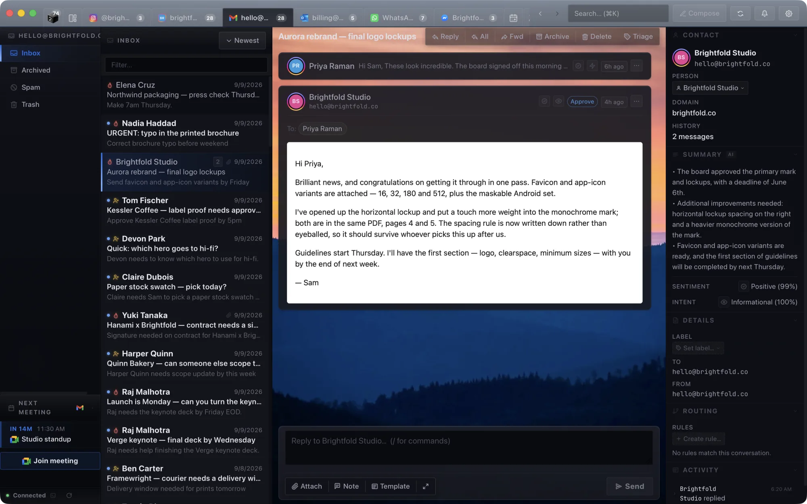

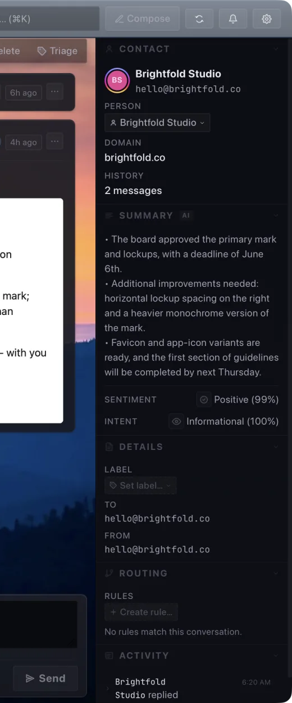{.half}

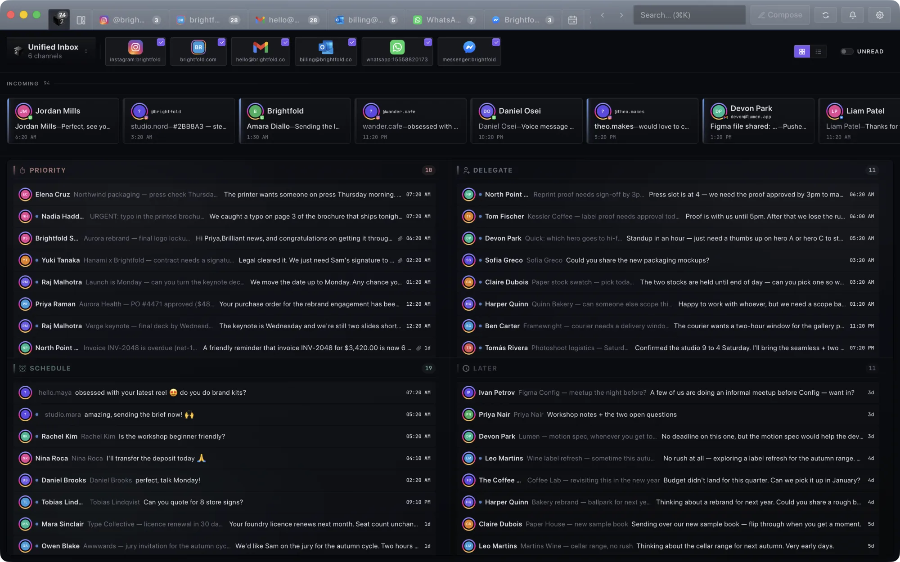

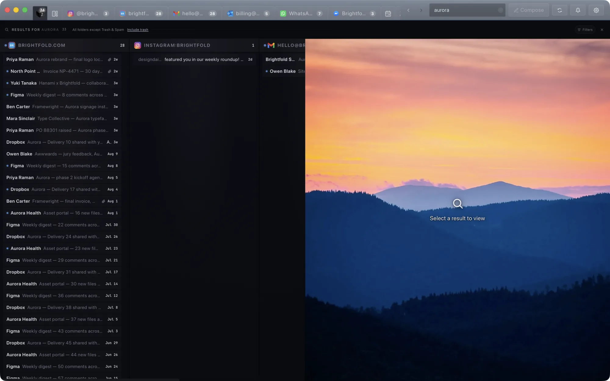

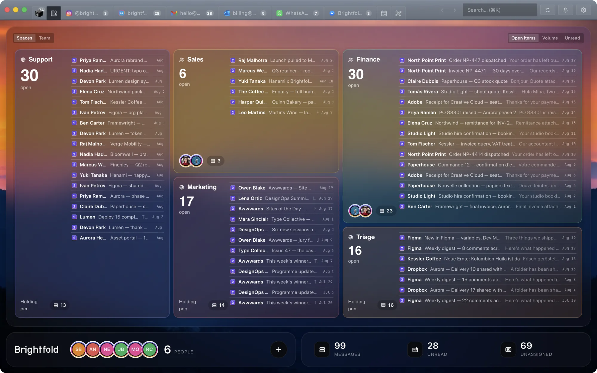

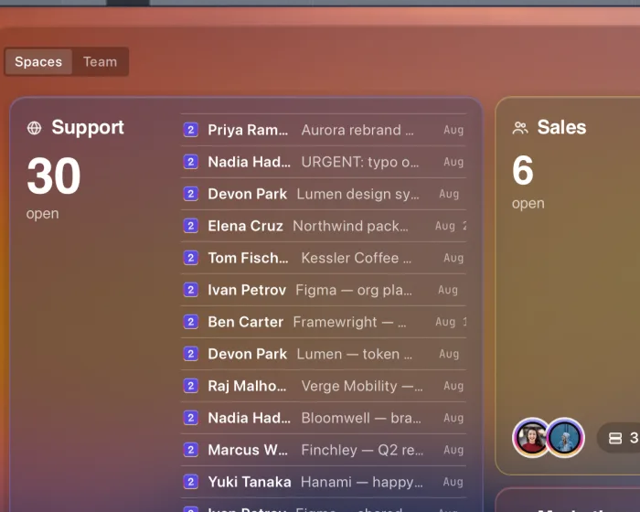{.half}

> **Decision** HTML mail renders in a sandboxed iframe with no scripts and a strict CSP. Remote images are blocked by default and fetched through the Rails image proxy. A direct load happens only on explicit consent. "Opening a message must not phone home." Source: `docs/Email-Rendering.md`.

> **Decision** Conversation selection uses `replaceStack`. A plain `replace` breaks the back button. In-app browser navigations live on `navigationStore.stack`. Source: `CLAUDE.md`, `docs/Routing.md`.

## Calendar and time

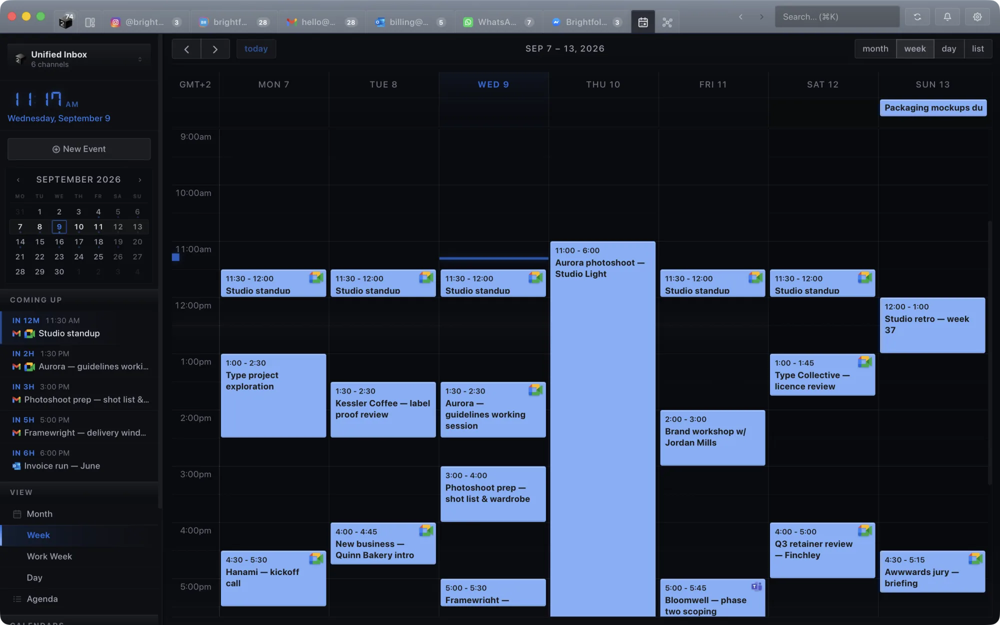

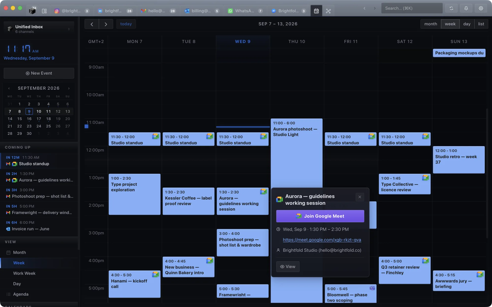

| Feature | Code | Scope |
|---|---|---|
| Day, week, month; event editor with recurrence; scheduling assistant; move dialog; mini calendar; next meeting | `pages/calendar/CalendarPage.jsx` (FullCalendar), `components/Calendar/*`, `hooks/useCalendarEvents.js` (MX API plus local SQLite), `lib/localCalendar.js`, `lib/recurrence.js`, `stores/calendarStore.js`; local writes `calendar_create_event`, `calendar_delete_event`, `calendar_reschedule_event`, `calendar_respond_event` | Both |
| Meeting invites: ICS RSVP, add to calendar, detected meetings, meet requests | `components/MeetingInvite/*`, `lib/invites.js`; local `respond_to_invite`, `add_invite_to_calendar`, `add_detected_meeting_to_calendar`, `detected_invite`, `invite_for_attachment`; MX `api.acceptMeetingRequest` | Both |
| Meeting reminders with snooze and ignore (client-side 30 s tick) | `hooks/useMeetingReminders.js`, `lib/meetingAlerts.js` | Both |
| Zones (focus blocks) and the "You're in the zone" card | `lib/zones.js`, `stores/zoneStore.js` (`/account/zones*`), `components/Calendar/ZoneEditor.jsx`, `ZoneSection.jsx`, `hooks/useZoneAlerts.js` | needs an inbox2 account |
| Time-zone planner | `components/Calendar/TimeZonePlanner.jsx`, `stores/plannerStore.js`, `lib/timeZones.js` | Both |
| Meet links and conferencing connections | Settings › Scheduling, public `pages/meet/MeetPage.jsx` | MX |

> **Decision** Calendar CRUD is MX-API-only; local-channel calendars are client-side and the calendar merges both at the client. Drag-to-reschedule on Google and Microsoft patches times only, because patching attendees resets RSVPs. Reminders are client-side by design: a server scheduler could reach only half the calendar. Source: `docs/Calendar.md`, `docs/Notifications.md`.

## Lore, Explorer, contacts

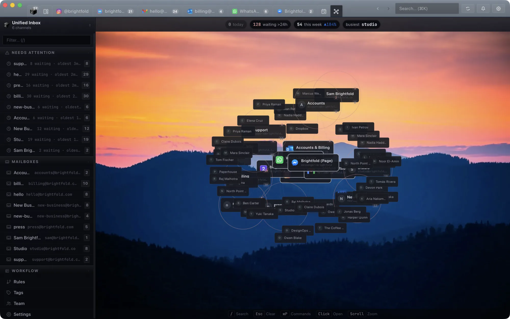

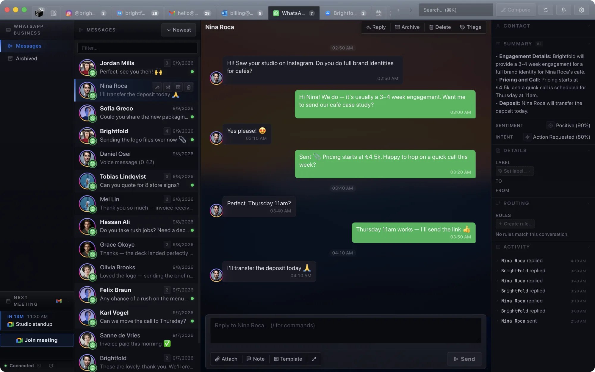

| Feature | Code | Scope |
|---|---|---|
| Lore: Today buckets, entity pages, Send to…, pages (Disk) | `pages/lore/*`, `components/Lore/*`, `lib/lore.js`, `hooks/useLore.js`, `useLoreFacts.js` (`lore_entities`, `lore_entity`, plus the API), `useLorePages.js`, `useLoreAuto.js` | Both; pages need Disk and an org |
| Explorer: entity graph by default, mailbox graph behind a toggle | `pages/command/CommandCenterPage.jsx`, `hooks/useExplorerGraph.js` (`lore_graph` plus `api.getLoreGraph`), `lib/entityGraph.js`, `lib/explorerPaint.js` | Both |
| Contact enrichment (Apollo) and contact popups | `components/InboxContextPanel/ApolloContact.jsx`, `lib/apollo-enrichment.js` (Tauri http plugin), `ContactPopup` | Both; no dedicated contacts screen |
| Local WhatsApp: read-only live database, send through Accessibility, media, tracked groups, Lore asks | `lib/localWhatsApp.js`, `lib/waMessages.js`, `pages/whatsapp/WhatsAppPage.jsx`, `components/WaChatPane/*`, `WaMediaViewer`, `hooks/useWaTrackedGroups.js`, `pages/lore/LoreWaGroup.jsx`; switched on in `AddAccountModal.jsx` | Desktop, macOS |
| Meta channels (WhatsApp Business, Messenger, Instagram) | `AddAccountModal/MetaConfigureForm.jsx`, `InstagramConnectForm.jsx`, `lib/metaApps.js`, `hooks/useInstagramOAuth.js` | Local |

> **Decision** Lore is the thread itself: done equals archived. Local to-do state therefore syncs through the provider and stays off the API. The ontology replaces the address graph in Explorer. Source: `docs/plans/lore.md`.

## Around the inbox

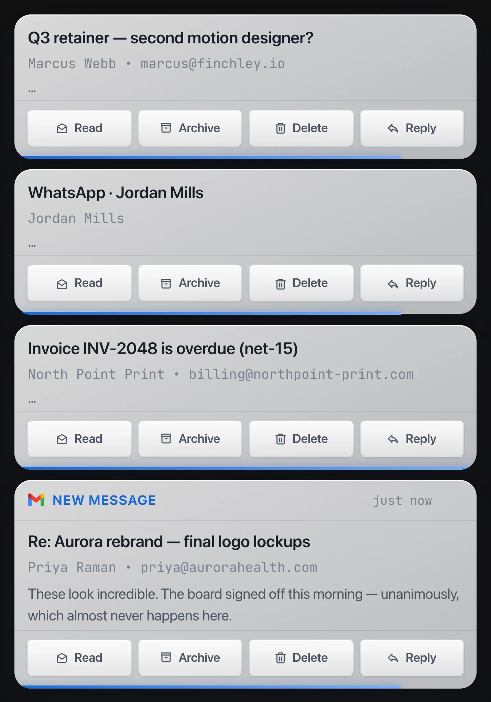{.half}

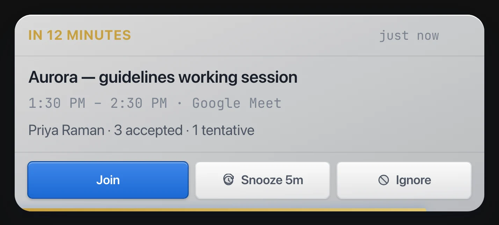

| Feature | Code | Scope |
|---|---|---|
| Notifications: custom popup window (default), system, or off; quick actions; sign-in codes; sounds; dock badge; tray title | `hooks/useNewMessageNotifications.js`, `pages/notification/NotificationPage.jsx`, `components/NewMessagePopup`, `MeetingAlert`, `stores/notificationStore.js`, `lib/notificationActions.js`, `lib/systemNotification.js`, `lib/notificationSound.js`, `hooks/useDockBadge.js`, `useTrayTitle.js` | Local verified; MX alerts on desktop unverified |
| Tray popover: unread summaries, coming up, month with day hover | `pages/tray/TrayPage.jsx`, `lib/trayData.js` | Desktop |
| Keyboard shortcuts, `?` help, Gmail/Outlook scheme | `lib/shortcuts.js` (the registry), `hooks/useInboxKeyboardNav.js`, `useMessageActionShortcuts.js`, `components/ShortcutsHelp` | Both |
| Command palette (⌘P) | `components/CommandPalette/*`, `stores/paletteStore.js` | Both |
| Touch Strip: clocks and planner, weather, stocks treemap, crypto, RSS, public IP; pinned, floating or hidden | `components/TouchStrip/*`, `lib/touchStrip.js` (localStorage plus `/account/touch-strip`), `hooks/useStripFeed.js` | Both |
| Themes, text size, app icon, rainbow tabs, custom backgrounds | `lib/themes.js`, `hooks/useTheme.js`, `pages/settings/ThemeSettings.jsx`, `lib/appIcon.js` | Both; app icon desktop |
| Account management: add, remove, reorder, resync, re-auth, diagnostics, folder selection, cloud push, sync console | `components/AddAccountModal/*`, `hooks/useExternalAccountSync.js`, `useOAuthFlow.js`, `SettingsPage.jsx`, `lib/accountOrderPref.js`, `hooks/useReauthAlert.js`, `lib/pushSync.js`, `components/SyncConsole`, `SyncStatusBar` | Local; MX through `MxLoginForm` |
| Credential vault and cloud backup | `pages/admin/StoredCredentialsCard.jsx`, `ChangePasswordModal.jsx` (`rotate_vault`) | Desktop with an MX session |
| Device link (sign in through the browser) | `lib/deviceLink.js`, `pages/auth/LinkDevicePage.jsx` | Desktop |
| MCP server (let agents use this inbox) | `lib/mcp.js`, `components/McpConnectCard` | Desktop |
| MCP client ("Send to…" Linear, GitHub, Jira, …) | `lib/mcpClient.js`, `pages/settings/McpConnectionsSettings.jsx`, `components/Lore/SendToDialog.jsx` | Desktop |
| AI: lanes, summaries, smart replies, classification, model downloads | `lib/ai/lanePrefs.js`, `hooks/useModelLanes.js`, `lib/ai/generative/tauriProvider.js`, `components/AISummaryPanel`, `SmartReplyBar`, `AIInsightsPanel`, `lib/ai/useAIClassification.js`, `modelManager.js` | Desktop |
| Updater: amber Update tag on the bell, panel row, Settings › About | `lib/updater.js`, `stores/updateStore.js`, `pages/settings/AboutSettings.jsx` | Desktop, release builds |
| DropBlock in the empty reading pane; animated theme backdrops | `components/DropBlock/*`, `stores/dropBlockStore.js`, `components/DotMatrix.jsx`, `lib/bonsai.js`, `lib/groovebox.js` | Both |
| Demo mode (⇧⌘D), dev mode (backtick), log viewer | `lib/demoData.js`, `hooks/useDevMode.js`, `pages/settings/org/LogViewerSettings.jsx`, `lib/log.js` | Both |
| Quit confirmation (⌘Q), external links from the email iframe | `components/AppMenuBridge`, `lib/openLink.js` | Desktop |

Four things stay off the desktop. Passkey sign-in, because `tauri://` is an invalid passkey origin. The console and Disk, which open in the browser. The Bridge voice assistant, which is mobile only; the desktop mentions it in AI settings copy and the Triage Lab.

## Stores

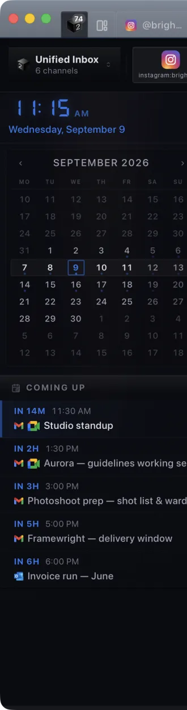{.half}

| Store (`web/stores/`) | Owns |
|---|---|
| `navigationStore` | page, org, account, conversation, filters, back-forward history; persists the open conversation |
| `accountStore`, `accountStatusStore` | the external account list; live per-account status |
| `unreadStore` | per-channel and total unread counts (exactly two writers, never derived from a list) |
| `notificationStore` | the notification stack, dismiss timing by priority, meeting and zone alert types |
| `undoStore` | undo and redo of mail actions |
| `paletteStore`, `plannerStore`, `calendarStore`, `zoneStore`, `explorerStore` | their screens |
| `updateStore` | available update, install progress, deferred, error |
| `dropBlockStore` | the game |

Singletons in `web/lib/`: `sync-manager.js` (the engine event bus), `mxMirror.js`, `localFirstApi.js`, `localData.js`, `pushSync.js`, `orgLiveMail.js` (web realtime MX nudges), `db.js` (the plugin-sql handle), `secretStore.js`, `prefStore.js`.
