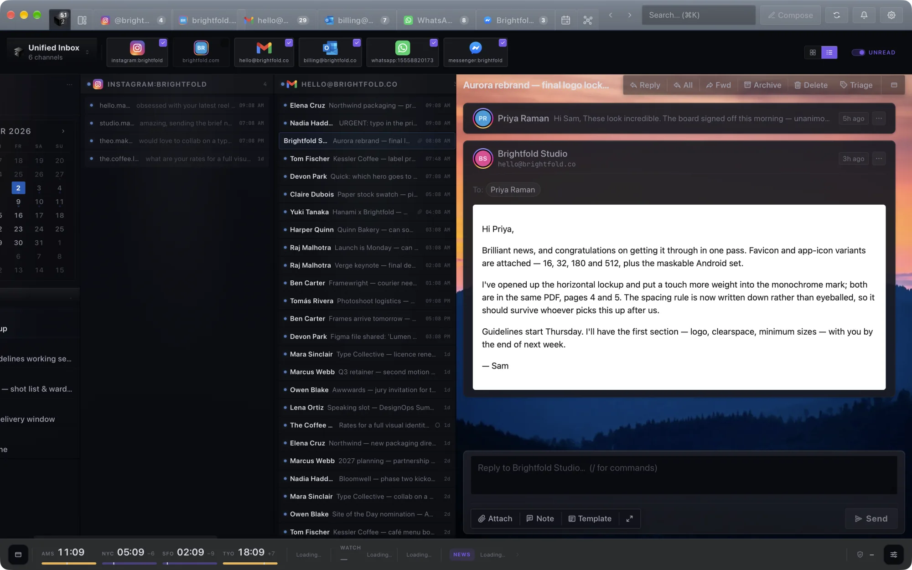

## The four setting stores

| Store | Reached by | Shared with |
|---|---|---|
| `localStorage` (keys in `web/lib/storageKeys.js`) | `prefStore.js` external stores | this app identity only; the CLI has its own `cli_prefs.json` |
| `engine_settings` (SQLite) | Tauri commands, the engine | every client on the machine, the CLI included |
| `app_secrets` (SQLite, encrypted) | `get_secret` / `set_secret` | every client on the machine |
| `users` row on the server | `PATCH /account`, `/account/*` | every device of the person |

Sections are declared in `pages/settings/settingsSections.js` with flags `desktop` (Tauri only), `hideDesktop`, `org` (needs a signed-in org), `admin`, `inConsole`.

## General

**Preferences** (`PreferencesSettings.jsx`)

| Setting | Values | Key | Affects |
|---|---|---|---|
| Mark-read mode | immediate, delay (default), selection change, never | `inbox2_mark_read_mode` | `useMarkRead` on every reading pane |
| Mark-read delay | 0.5 to 60 s, default 2.5 | `inbox2_mark_read_delay` | same |
| Alert mode | custom popup (default), system, off | `inbox2_notification_mode` (`inbox2_notifications_enabled` legacy) | the notification window, system notifications |
| Cloud push | on (default) / off | `inbox2_cloud_push_enabled` | `register_push` for Gmail and Microsoft |
| Sounds, receive and send sound | on/off, catalog entries | `inbox2_sounds_enabled`, `inbox2_sound_receive`, `inbox2_sound_send` | `play_alert_sound` |
| DropBlock in the empty pane | on/off | `inbox2_dropblock_enabled` | the empty reading pane |

**Account and profile** (`AccountSettings.jsx`): display name, default language (`PATCH /account`), avatar (`POST /account/avatar`), and the danger zone: clear local data (`clear_local_data`).

**Connected accounts** (`SettingsPage.jsx` `ConnectedAccountsSection`): list, add, remove, resync and diagnostics. Per account: open tracking (`set_open_tracking`, cloud `api.setChannelTracking`, custom tracking host register and verify). Also here: the private image proxy toggle (`inbox2_image_proxy_enabled`) and the inbox2 API key (`ink_…`, secret `cloud_auth_token`).

**Theme** (`ThemeSettings.jsx`, `lib/themes.js`)

| Setting | Values | Key |
|---|---|---|
| Theme | `dark-warm` (default), `dark`, `light`, `dark-stars`, `soiree`, `atelier`, `groovebox` | `inbox2_theme` |
| App icon (desktop) | catalog | `inbox2.appIcon` + `set_app_icon` |
| Token overrides, import and export | per-token colours | `inbox2_theme_overrides` |
| Background | default, none, custom | `inbox2_theme_backgrounds` |
| Text size | 0.9, 1, 1.1, 1.2 | `inbox2_text_scale` |
| Rainbow tabs | on/off | `inbox2_rainbow_tabs` |

The setup wizard's Look step writes the same keys and `inbox2_setup_theme_picked`.

## Workspace (need an org)

| Section | Desktop | Component | Storage |
|---|---|---|---|
| Spaces | hidden | `org/SpacesSettings.jsx` | org API |
| Triage labels | hidden | `org/TriageLabelsSettings.jsx` | `/orgs/:id/triage-labels` |
| Routing rules | in the console | `org/RulesSettings.jsx` | org API, admin |
| Scheduling: meet links, conferencing connections, time zone, working hours, work days, out of office | shown | `SchedulingSettings.jsx`, `AvailabilitySettings.jsx` | `api.createMeetLink/listMeetLinks/revokeMeetLink`, `api.connectConferencing/…`, `PATCH /account` |
| Webhooks | shown | `org/WebhooksSettings.jsx` | org API, admin |
| Single sign-on | hidden | `org/SsoSettings.jsx` | org API, admin |

> **Decision** Scheduling settings live in the mail app, deliberately not on a console page. Source: `docs/Calendar.md`.

## Intelligence

**Enrichment** (`IntegrationsSettings.jsx`): the Apollo API key, secret `apollo_api_key`.

**On-device AI** (desktop, `AIFeaturesSettings.jsx`)

| Setting | Key | Affects |
|---|---|---|
| Enable on-device AI (consent) | `inbox2_ai_consent`, model metadata `inbox2_ai_models` | tier-A classification, model downloads |
| Generation lane | `inbox2_nlu_lane` (`auto` default, `native`, `free`, `openai`), pushed with `set_ai_config` | summaries, smart replies, compose |
| Free-model variant | `inbox2_nlu_free_model` (Qwen 2.5 1.5B default, Gemma 3 1B) | the free lane |
| OpenAI key | secret `openai_api_key` | the openai lane |
| Local agents enabled per CLI | `set_local_agent_enabled` → `local_agents` | the `run_agent` action |
| MCP server on/off, agent access tier | `mcp_set_enabled` → `vector_settings.mcp_server_enabled`, `mcp_set_agent_access` | the loopback MCP listener |

**Triage and sync** (desktop, `TriageSyncSettings.jsx`)

| Setting | Key | Affects |
|---|---|---|
| Jev key | secret `typesafe_api_key`, `set_jev_key`, `validate_jev_key` | triage on local channels; without it rules only |
| Processing window | `engine_settings.processing_window`: new mail only, 30 d (default), 90, 180, 360, everything | which threads the TriageWorker picks up |
| Org-spaces classifier | `engine_settings.space_classify_enabled` | space assignment for local mail |
| Local triage labels | `engine_settings.triage_labels` | the label set Jev chooses from |

**Auto rules** (desktop, `LocalRulesSettings.jsx` → `RuleManager`): local rules stored in `local_rules`.

**Connected apps (MCP)** (desktop, `McpConnectionsSettings.jsx`): name, URL, token or OAuth client, through the `mcp_*` commands; connections in `engine_settings.mcp_client_connections`, tokens in `app_secrets`.

## Security and compliance

Spam and filtering (`org/SpamSettings.jsx`, org admin), app logs (`org/LogViewerSettings.jsx`), About (desktop: version, check and install updates).

Present in the tree but not mounted anywhere: `SecuritySettings.jsx`, `ProfileSettings.jsx`, `NotificationPreferences.jsx`.

## UI state outside Settings

All in localStorage, all declared in `web/lib/storageKeys.js` unless noted:

| Key | Holds |
|---|---|
| `inbox2_active_account`, `inbox2_active_conversation` | restored on boot |
| `inbox2_unified_view_mode`, `inbox2_unified_unread_only`, `inbox2_sort` | list view and sort |
| `inbox2_collapsed_panels`; `inbox2_sidebar_width`, `inbox2_list_width`, `inbox2_context_width`, `inbox2_cal_sidebar_width`, `inbox2_explorer_sidebar_width` (local constants) | panels |
| `inbox2_preview_pane_mode`, `inbox2_calendar_rail_mode`, `inbox2_lore_pane_mode` | pane modes |
| `inbox2_touch_strip_mode`, `inbox2_touch_strip_config` (also synced to `/account/touch-strip`) | Touch Strip |
| `inbox2_compose_preview`, `inbox2_event_preview` | previews |
| `inbox2_tz_planner_zones`, `inbox2_tz_planner_labels` | time-zone planner |
| `inbox2_zone_dismissed`, `inbox2_zone_hidden_categories`, `inbox2_calendar_pastels` | calendar |
| `inbox2_local_whatsapp` (mirrored to the engine with `wa_lore_set_enabled`), `inbox2_wa_open_columns` | WhatsApp |
| `inbox2_sync_folders`, `inbox2_account_order` | accounts |
| `inbox2_last_from_address`, `inbox2_last_event_calendar` | last used |
| `inbox2_dev_mode`; `inbox2_setup_complete`, `inbox2_setup_theme_picked` (`lib/setupMode.js`) | modes |
| `inbox2_cached_account`, `inbox2_apollo_cache` | caches |
| `inbox2_dropblock_state`, `inbox2_dropblock_muted`, `inbox2_activity_collapsed`, `inbox2_meeting_alerts_fired`, `inbox2_ai_onboarding_dismissed` | small UI state |
| `inbox2:demo-mode`, `inbox2:demo-salt` (sessionStorage) | demo mode |

