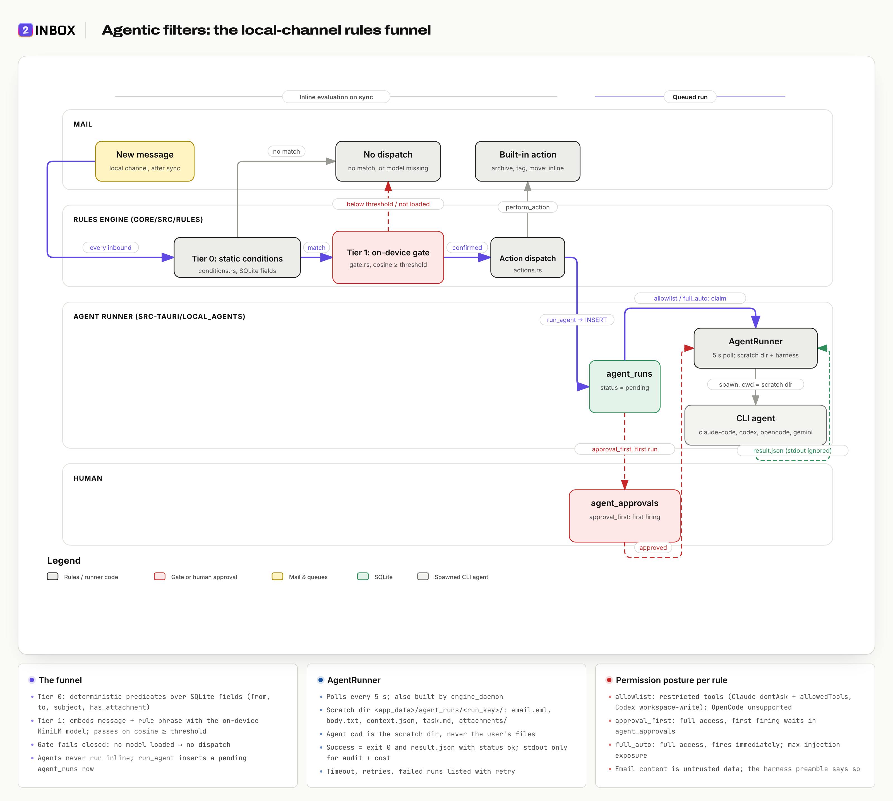

## Lanes

Every generative capability (summary, smart replies, compose, the Bridge brief on mobile) runs on one of three lanes. The person chooses the lane in Settings › On-device AI (`inbox2_nlu_lane`, default `auto`); the UI pushes it to the engine with `set_ai_config`.

| Lane | Runs | Where |
|---|---|---|
| `native` | Apple Intelligence through `FoundationModelsBridge` (macOS 26) | on device |
| `free` | Qwen2.5-1.5B (default) or Gemma 3 1B, GGUF, through the `llama-server` sidecar; downloaded on demand with `model_download`, resumable, sha256-checked (`core/bridge/models/`) | on device |
| `openai` | OpenAI with the person's own key (`openai_api_key`) | cloud |

`core/bridge/models/models.json` is the manifest; the same lanes exist on iOS and Android with the same sampling settings. Tier-A classification (sentiment, intent, embeddings: `ai_sentiment`, `ai_intent`, `ai_embedding`) uses ONNX models through `ort`, managed by `web/lib/ai/modelManager.js`.

> **Decision** The free lane is Qwen2.5-1.5B on every platform. Gemma 3 1B is an opt-in variant: it is English-only, it misread Dutch, and its JSON compliance is the worst. Source: `docs/AI-Lanes-and-Eval.md`.

## Prompts

All prompts live in `core/bridge/prompts.toml`, embedded in every client. A copy in the app data dir overrides sections at startup; a missing section falls back; an invalid override changes nothing. Sections: `[chat]`, `[brief]`, `[tomorrow]`, `[week]`, `[draft_reply]`, `[summary]`, `[intent]`, `[smart_replies]`, `[summarize]`, `[openai]`. The UI edits them with `prompts_get` / `prompts_set` / `prompts_reset`.

```toml
# core/bridge/prompts.toml: the embedded defaults for every client.
# A copy in <app data dir>/prompts.toml overrides these texts at startup;
# sections left out fall back to the defaults below.
[chat]
system = '''
You are the Bridge, a concise voice assistant for a shared team inbox and calendar.
Reply in one or two short spoken sentences.
The current local date and time is {now}.
...
'''
```

The `[triage]` section is retired: Jev classifies, and the labels are data.

## Triage

Triage is one typed call per thread to Jev (TypeSafe System One, `core/typesafe.rs`). Jev returns the action label, a 0 to 4 priority, and the Space. The labels are the eight built-ins plus `payment_due`, `to_review`, `read_later`, `receipt` and `notification`, plus org and personal custom labels. For MX mail the server runs the call and the desktop reads the result. For local channels the `TriageWorker` (`core/ai_worker.rs`, 5 s poll, 90 s timeout) runs it with the person's own key (`typesafe_api_key`). Without a key, local mail gets rules only. The processing window (`engine_settings.processing_window`, default 30 days) bounds the backlog. `triage_progress` reports it and `retriage_conversation` re-runs one thread.

Sealed mail gets label, priority and space only. A stored summary is plaintext content, so sealed mail gets none.

> **Decision** Triage classification is Jev (2026-09-19); the OpenAI and on-device classifiers are gone. Summaries stay on the text lanes. The label drives badges and sorting and, after opt-in, auto archive and trash per bucket. Nothing else acts on the label, because of prompt injection. Source: `docs/Triage.md`.

The parity contract between the Ruby and Rust sides is the `jev_triage` fixture in `fixtures/parity/fixtures.json`, included by `core/parity_tests.rs` and read by `api/spec/services/cross_language_parity_spec.rb`. The eval harness is `core/triage_eval.rs`, `cargo run --bin triage-eval -- fixtures/triage-eval.json`, and the Triage Lab page on the desktop.

## Lore

Lore is the open-workload layer. It holds the to-dos extracted from mail (`lore_todos`, next action and due date) and the ontology of organisations, people, products and projects (`lore_entities`, `lore_facts`, `lore_mentions`). On the desktop `core/ontology.rs` mines local-channel mail every 60 s. It runs a deterministic header pass on every plan, then a grounded LLM pass (`ground`, `defang`, `salvage`). Confidence is `min((1 - 0.5^support) × grounding, 0.95)` with floor 0.5, and there is no review queue. MX mail is mined on the server. Sealed and private mail stay out of every server model. `shell/whatsapp_lore.rs` adds asks from WhatsApp chats and tracked business groups; Jev judges whether a reply completed them.

## Local rules and agents



A local rule (`local_rules`, `shell/local_agents/store.rs`) is evaluated when a channel message is persisted:

```rust
pub struct LocalRule {
    pub key: String,
    pub name: String,
    pub account_key: Option<String>,
    pub conditions: Vec<Condition>,          // Tier 0: static, in Rust/SQLite
    pub ai_gate: Option<serde_json::Value>,  // Tier 1: on-device, fails closed
    pub action: RuleAction,                  // Tier 2: built-in or run_agent
    pub enabled: bool,
}
```

| Tier | Cost | What |
|---|---|---|
| 0, static predicate (`core/rules/conditions.rs`) | ~0 ms | sender, subject, attachment, folder; most mail dies here |
| 1, on-device gate (`core/rules/gate.rs`) | 50 to 300 ms | "is this really an invoice?" on the shared AI engine; below threshold drops; fails closed |
| 2, action (`core/rules/actions.rs`) | | built-ins (archive, delete, mark read, auto-triage, auto-label) or `run_agent` |

`run_agent` appends to `agent_runs`. The `AgentRunner` (`shell/local_agents/runner.rs`, 5 s poll) picks an installed CLI agent through its `AgentAdapter` (claude-code, codex, opencode, gemini; detected with `detect_local_agents`). It spawns the agent in a throwaway scratch directory with a preamble that frames mail as data, and reads `result.json` back. Stdout is ignored. A timeout and a kill bound the run, and every run is audited.

The permission mode is a field on the rule's action, chosen in the create-rule popup:

| Mode | Meaning |
|---|---|
| `allowlist` | restricted tools or sandbox (Claude `dontAsk` plus allowlist, Codex `--sandbox workspace-write`); disabled for agents without allowlist support |
| `approval_first` | full access, but the first firing needs one human approval in `agent_approvals`; later firings run unattended |
| `full_auto` | full access, no gate |

> **Decision** `run_agent` is the single Tier-2 agent action; it replaced the webhook-dispatch idea. Local channels only, desktop only. Prompt injection is the headline risk, because the agent's input is an email the attacker controls. The defences are cwd isolation, least privilege by default, first-run approval and a full audit trail. OS sandboxing is future work. Source: `docs/Agentic-Filters.md`.

MX rules are a different system: server-side `Rule` / `RuleExecutor`, edited through the same wizard with the `lib/mxRules.js` backend. On sealed domains, content conditions silently match nothing.

## MCP server: agents use this inbox

`shell/mcp/` serves the inbox to AI agents over loopback HTTP: `127.0.0.1:${INBOX2_MCP_PORT:-8765}/mcp`, bearer token from `<data>/mcp-token`. The Settings card toggles `vector_settings.mcp_server_enabled`. On a fresh install the server is off: `setup::maybe_start_mcp` starts it only when that setting is the string `"true"`. The protocol is dual-era: the stateless 2026-07-28 spec and the legacy `initialize` session. There are 23 tools and four resources. The tools: `list_accounts`, `list_folders`, `list_conversations`, `read_conversation`, `read_message`, `search_messages`, `search_similar`, `list_attachments`, `get_attachment`, `get_calendar_events`, `get_contact_context`, `archive`, `trash`, `delete`, `mark_read`, `mark_unread`, `move_to_folder`, `add_tag`, `remove_tag`, `set_priority`, `compose_draft`, `create_conversation`, `send_message`.

| Tier | Can | Cannot |
|---|---|---|
| `read` (default) | search, read, list, calendar, contacts | any mutation |
| `read_write` | plus drafts, mark read, archive, tag, move, priority | send, delete |
| `full` | everything | |

Every call is audited (`agent_audit_log`). Privileged calls (`send_message`, `create_conversation`, `trash`, `delete`) wait in `agent_approvals` unless auto-approve is on. Full access sets auto-approve, because nothing in the app asks a person to approve; an agent with Full access therefore sends unattended. Reads come from the `agent_*` views, which hold unsealed mail only. Sends and drafts are durable queue rows. Gmail permanent delete is refused. Tags are added one at a time, so a stale mirror cannot undo a teammate's tag.

Search behind `search_messages` is hybrid: FTS5 plus `message_embeddings` fused with RRF (`shell/vector/`). The desktop UI itself uses keyword search only.

## MCP client: Send to…

`core/mcp_client/` is a Streamable-HTTP JSON-RPC client with OAuth 2.1 discovery, dynamic client registration and PKCE over the device-link loopback. Connections live in `engine_settings.mcp_client_connections`, tokens in `app_secrets`. Presets: Linear, GitHub, Atlassian, Notion, Sentry, HubSpot, Asana, Salesforce. The only caller of `mcp_call_tool` is the Create button in `SendToDialog`. The prefill uses the subject, the Lore detail and the sender; the full body stays on the device. Tool results and schemas are untrusted and shown as plain text.

> **Decision** Draft-only, desktop-only (2026-10-20). Every call starts from the Create button. This repeats the Bridge rule "never sends". Source: `docs/MCP-Client.md`.

